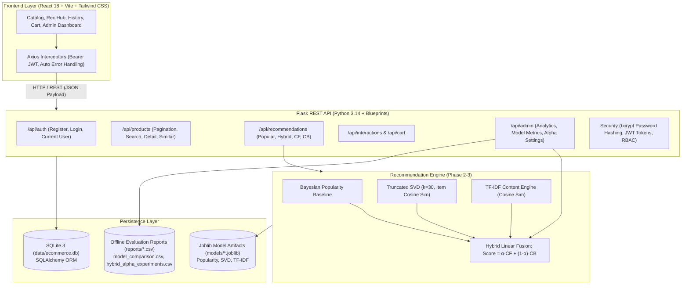

# Personalized E-Commerce Recommendation System
## Hybrid Recommendation Using Collaborative Filtering + Content-Based Filtering

[](https://www.python.org/)
[](https://flask.palletsprojects.com/)
[](https://react.dev/)
[](https://tailwindcss.com/)
[](https://vitejs.dev/)
[-success.svg)](#11-automated-testing--verification-suite)
[](https://huggingface.co/datasets/McAuley-Lab/Amazon-Reviews-2023)

A full-stack, research-grade Personalized E-Commerce Recommendation System implementing a hybrid algorithmic architecture (Truncated SVD Collaborative Filtering + TF-IDF Cosine Similarity Content-Based Filtering) evaluated over **8,337 catalog products** and **2,064 test users** from the real-world **Amazon Reviews 2023** public dataset.

---

## 1. Project Overview & Objectives

### 1.1 Problem Statement
Modern e-commerce platforms confront two fundamental information retrieval challenges:
1. **The Cold-Start Dilemma:** New users and items lack sufficient historical interaction records for pure collaborative filtering.
2. **Extreme Matrix Sparsity:** Real-world transaction and review matrices typically exceed 99.9% sparsity, hindering neighborhood and latent factor discovery.

### 1.2 Objectives
- Develop a production-grade e-commerce web application with real dataset ingestion, exploratory data analysis, and persistent machine learning models.
- Implement four distinct recommendation paradigms:
  1. **Bayesian Weighted Popularity Baseline** ($m=3$, $C=4.5459$)
  2. **Truncated SVD Matrix Factorization** ($k=30$ latent factors)
  3. **TF-IDF Content-Based Filtering** (5,000 unigram/bigram vocabulary)
  4. **Dynamic Linear Fusion Hybrid Engine** ($\alpha \cdot \text{CF} + (1 - \alpha) \cdot \text{CB}$)
- Execute a leak-free temporal holdout offline evaluation quantifying Precision@K, Recall@K, F1@K, NDCG@K, MAP@K, Catalog Coverage, and Intra-List Diversity.
- Deliver an interactive administrator telemetry dashboard with live hyperparameter weight adjustment ($\alpha$), real SQLite analytics, and strict Role-Based Access Control (RBAC).

---

## 2. System Architecture

The application adopts a decoupled, multi-tiered architecture:



Complete technical diagrams and data flow sequence specifications are available in [`docs/architecture.md`](file:///c:/Users/MI/OneDrive/Desktop/e-commerce/docs/architecture.md).

---

## 3. Recommendation Algorithms & Formulation

### 3.1 Bayesian Weighted Popularity Baseline
Mitigates rating volatility on items with very few reviews using empirical Bayesian shrinkage:
$$\text{Score}(i) = \frac{v_i}{v_i + m} \cdot R_i + \frac{m}{v_i + m} \cdot C$$
- $v_i$: Observed interaction count for product $i$.
- $R_i$: Arithmetic mean rating of product $i$.
- $m$: Minimum interaction threshold ($m = 3$).
- $C$: Global mean rating across the entire catalog ($C = 4.5459$).

### 3.2 Collaborative Filtering (Truncated SVD)
Decomposes the high-sparsity user-item interaction matrix $R \in \mathbb{R}^{2243 \times 8337}$ into $k=30$ latent factors:
$$R \approx U_k \Sigma_k V_k^T$$
Predicted preference: $\hat{r}_{u,i} = \mathbf{u}_u \cdot \mathbf{v}_i^T$. Item similarity in latent space:
$$\text{sim}_{\text{CF}}(i, j) = \frac{\mathbf{v}_i \cdot \mathbf{v}_j}{\|\mathbf{v}_i\| \|\mathbf{v}_j\|}$$

### 3.3 Content-Based Filtering (TF-IDF + Cosine Distance)
Extracts unigram and bigram token features from concatenated metadata (`title`, `category`, `description`) across a 5,000-term vocabulary with sublinear term-frequency scaling.
User profile vector:
$$\mathbf{p}_u = \sum_{j \in H_u} w_{u,j} \cdot \mathbf{d}_j + \sum_{c \in P_u} \gamma_c \cdot \mathbf{c}_c$$
Cosine similarity:
$$\text{Score}_{\text{CB}}(u, i) = \frac{\mathbf{p}_u \cdot \mathbf{d}_i}{\|\mathbf{p}_u\| \|\mathbf{d}_i\|}$$

### 3.4 Hybrid Recommendation Engine
Normalizes collaborative and content-based candidate scores into $[0, 1]$ via Min-Max scaling, then applies linear fusion:
$$\text{Score}_{\text{Hybrid}}(u, i) = \alpha \cdot \text{Score}_{\text{CF, norm}}(u, i) + (1 - \alpha) \cdot \text{Score}_{\text{CB, norm}}(u, i)$$
- Configurable parameter $\alpha \in [0.0, 1.0]$.
- Prior interacted items are strictly filtered out of recommendation candidates.
- Cold users gracefully fallback to weighted category onboarding preferences and popularity baselines.

---

## 4. Dataset Specification & Pipeline

- **Source:** Amazon Reviews 2023 (Julian McAuley Lab, University of California San Diego / Hugging Face).
- **Categories Ingested:** `Digital Music` (5,339 products), `All Beauty` (1,499 products), `Appliances` (1,499 products).
- **Total Products:** **8,337**.
- **Total Raw Interactions:** **39,946**.
- **Dense Core Filtering:** Users with $\ge 2$ interactions and items with $\ge 2$ interactions formed the 5,236 dense-core interaction training matrix ($99.9869\%$ sparsity).
- **Train/Test Splitting Protocol:** Per-user leak-free temporal split reserving subsequent interactions exclusively for evaluation ($N=2,064$ test users).
- **Documented Limitations:**
  - Interaction events are derived from verified Amazon reviews and product ratings (used as proxies for purchase/engagement behavior).
  - Missing product prices were imputed using category medians.
  - Image URLs are preserved from the original dataset; local fallback icons are provided for records without image assets.

---

## 5. Offline Model Evaluation Results

Empirical evaluation on $N=2,064$ test users ($K=10$):

| Recommendation Model | Recall@10 | Precision@10 | F1@10 | NDCG@10 | MAP@10 | Coverage (%) | Diversity |
| :--- | :---: | :---: | :---: | :---: | :---: | :---: | :---: |
| **Popularity Baseline** | 1.07% | 0.11% | 0.00194 | 0.00432 | 0.00243 | 0.13% | **0.9402** |
| **Collaborative Filtering (SVD)** | 8.16% | 0.86% | 0.01553 | 0.04895 | 0.03857 | 3.75% | 0.9106 |
| **Content-Based Filtering (TF-IDF)** | 19.69% | 2.02% | 0.03656 | 0.12967 | 0.10834 | **43.29%** | 0.5963 |
| **Hybrid Engine ($\alpha=0.50$)** | 20.07% | 2.06% | 0.03734 | 0.12503 | 0.10124 | 32.06% | 0.6899 |
| **Hybrid Engine ($\alpha=0.25$ Optimum)** | **20.99%** | **2.16%** | **0.03901** | **0.14199** | **0.12038** | 41.63% | 0.5945 |

### Key Algorithmic Findings:
1. **$\alpha=0.25$ Peak Accuracy:** Combining 25% collaborative filtering signal with 75% content metadata produced the highest Recall@10 (20.99%) and ranking NDCG@10 (0.1420).
2. **Cold-Start Resilience:** Pure collaborative filtering collapses to 3.75% catalog coverage; Content-Based and Hybrid models successfully explore the catalog long-tail (up to 43.29% coverage).

---

## 6. Database Entity Schema (SQLAlchemy ORM)

| Table | Purpose | Key Columns / Constraints |
| :--- | :--- | :--- |
| `users` | Accounts & roles | `id`, `name`, `email` (unique), `password_hash` (bcrypt), `role` (`admin`/`user`), `created_at` |
| `products` | Catalog items | `id`, `external_product_id` (unique ASIN), `title`, `category`, `price`, `rating`, `image_url` |
| `user_preferences` | Category weights | `id`, `user_id` (FK `users.id`), `category`, `preference_weight` |
| `interactions` | Activity tracking | `id`, `user_id` (FK), `product_id` (FK), `interaction_type` (`view`/`like`/`rating`/`cart`/`purchase`), `rating`, `timestamp` |
| `recommendation_logs` | Audit telemetry | `id`, `user_id` (FK), `product_id` (FK), `algorithm`, `recommendation_score`, `created_at` |
| `user_cart` | Shopping cart | `id`, `user_id` (unique FK `users.id`), `created_at`, `updated_at` |
| `cart_items` | Cart line items | `id`, `cart_id` (FK `user_cart.id`), `product_id` (FK `products.id`), `quantity` |
| `orders` | Placed user orders | `id`, `user_id` (FK `users.id`), `status` (`PENDING`/`CONFIRMED`/`CANCELLED`/`COMPLETED`), `total_amount`, `created_at`, `updated_at` |
| `order_items` | Order line items | `id`, `order_id` (FK `orders.id`), `product_id` (FK `products.id`), `quantity`, `unit_price`, `subtotal`, `created_at` |

---

## 7. Installation & Quickstart (Windows PowerShell)

### Prerequisites
- Python 3.10+ (Verified on Python 3.14.7)
- Node.js 18+ & npm 10+ (Verified on Node v24.18.1 / npm 11.16.0)

### 7.1 Clone & Backend Setup
```powershell
# 1. Open Windows PowerShell in project root
cd c:\Users\MI\OneDrive\Desktop\e-commerce

# 2. Create and activate Python virtual environment
python -m venv .venv
.venv\Scripts\Activate.ps1

# 3. Install Python backend dependencies
pip install -r backend\requirements.txt

# 4. Configure environment variables
Copy-Item .env.example .env
```

### 7.2 Dataset Preprocessing, Database Ingestion & Model Training
```powershell
# 5. (Optional) Ingest and preprocess raw Amazon Reviews 2023 dataset from Hugging Face
# Ingests All_Beauty, Appliances, and Digital_Music, extracts metadata, creates dense core splits:
python backend\scripts\preprocess_data.py

# 6. Initialize SQLite database and populate catalog with 8,337 Amazon products and seed accounts
python backend\scripts\import_products.py

# 7. Train and persist machine learning recommendation models (Popularity, Truncated SVD, TF-IDF)
python backend\scripts\train_models.py

# 8. Run offline model evaluation and generate benchmark reports
python backend\services\evaluation.py
```

### 7.3 Frontend Setup
```powershell
# 9. Install frontend npm dependencies
cd frontend
npm install
cd ..
```

### 7.4 Running the Application
Open two separate terminal windows:

**Terminal 1 — Flask API Server:**
```powershell
python backend\app.py
# Server running at: http://localhost:5000
```

**Terminal 2 — React Vite Client:**
```powershell
cd frontend
npm run dev
# Client running at: http://localhost:5173
```

### 7.5 Render Cloud Production Deployment

The project includes infrastructure-as-code ([`render.yaml`](file:///c:/Users/MI/OneDrive/Desktop/e-commerce/render.yaml)) supporting zero-configuration automated deployment on [Render](https://render.com):

#### Option A: One-Click Blueprint Deployment (Recommended)
1. Fork or push this repository to GitHub: `https://github.com/priyampriya15-stack/personalized-ecommerce-recommender.git`.
2. In the [Render Dashboard](https://dashboard.render.com), click **New +** $\rightarrow$ **Blueprint**.
3. Connect your GitHub repository. Render will automatically parse [`render.yaml`](file:///c:/Users/MI/OneDrive/Desktop/e-commerce/render.yaml) and configure both services.
4. Click **Apply**. Render will automatically build the backend web service and the frontend static site with SPA rewrite rules.

#### Option B: Manual Service Configuration
1. **Backend Web Service (`personalized-ecommerce-api`):**
   - **Environment:** `Python 3`
   - **Root Directory:** `./`
   - **Build Command:** `pip install -r backend/requirements.txt && python backend/scripts/init_production.py`
   - **Start Command:** `gunicorn app:app --bind 0.0.0.0:$PORT --workers 2 --timeout 120`
   - **Health Check Path:** `/api/health`
   - **Environment Variables:**
     - `FLASK_ENV`: `production`
     - `SECRET_KEY`: *(Auto-generated 256-bit string)*
     - `JWT_SECRET_KEY`: *(Auto-generated 256-bit string)*
     - `DATABASE_URL`: `sqlite:///data/ecommerce.db`
     - `FRONTEND_URL`: `https://personalized-ecommerce-frontend.onrender.com`
     - `DEFAULT_HYBRID_ALPHA`: `0.25`
2. **Frontend Static Site (`personalized-ecommerce-frontend`):**
   - **Build Command:** `cd frontend && npm install && npm run build`
   - **Publish Directory:** `frontend/dist`
   - **Routes (Rewrite):** `/*` $\rightarrow$ `/index.html` (preserves React Router deep-links)
   - **Environment Variable:** `VITE_API_BASE_URL=https://personalized-ecommerce-api.onrender.com/api`

#### Database Persistence Notice (SQLite on Render)
- **Render Disks (Paid Tiers):** For permanent filesystem persistence across restarts, attach a 1GB Render Disk mounted at `/data` and set `DATABASE_URL=sqlite:////data/ecommerce.db` and `DATA_DIR=/data`.
- **Render Free Tier:** The container filesystem is ephemeral; state resets on cold restarts. [`init_production.py`](file:///c:/Users/MI/OneDrive/Desktop/e-commerce/backend/scripts/init_production.py) automatically runs on each build to ensure schema and initial catalog integrity.

---

## 8. Pre-Seeded Default Accounts

| Role | Email | Password | Access Rights |
| :--- | :--- | :--- | :--- |
| **System Administrator** | `admin@ecommerce.com` | `Admin@123` | Full Admin Dashboard (`/admin`), Model Control, Telemetry |
| **Demo User** | `demo@ecommerce.com` | `Demo@123` | Personal Profile, History, Recommendations |
| **Active Seed User** | `activeuser@ecommerce.com` | `User@123` | Pre-loaded with 20 historical interaction events |

---

## 9. API Reference

| Endpoint | Method | Auth Required | Description |
| :--- | :---: | :---: | :--- |
| `/api/auth/register` | `POST` | Public | Register new user account |
| `/api/auth/login` | `POST` | Public | Authenticate user & return signed JWT |
| `/api/auth/me` | `GET` | Bearer JWT | Retrieve current profile & preferences |
| `/api/products` | `GET` | Public | Paginated catalog (`page`, `limit`, `category`, `sort`) |
| `/api/products/<id>` | `GET` | Public | Product details by ID or ASIN |
| `/api/products/search` | `GET` | Public | Free-text search across titles & descriptions |
| `/api/products/<id>/similar` | `GET` | Public | Top similar products via TF-IDF cosine distance |
| `/api/recommendations/popular` | `GET` | Public | Non-personalized Bayesian popularity baseline |
| `/api/recommendations/<user_id>/hybrid` | `GET` | Bearer JWT | Personalized Hybrid recommendations ($\alpha \cdot \text{CF} + (1-\alpha) \cdot \text{CB}$) |
| `/api/recommendations/<user_id>/collaborative` | `GET` | Bearer JWT | SVD latent matrix factorization recommendations |
| `/api/recommendations/<user_id>/content-based` | `GET` | Bearer JWT | TF-IDF profile recommendations with explanations |
| `/api/interactions` | `POST` | Bearer JWT | Record view, like, rating, or cart interaction |
| `/api/users/<user_id>/history` | `GET` | Bearer JWT | User's chronological interaction timeline |
| `/api/users/preferences` | `POST` | Bearer JWT | Save category preferences with tiered weights |
| `/api/cart` | `GET` | Bearer JWT | Retrieve shopping cart and subtotal |
| `/api/cart/items` | `POST` | Bearer JWT | Add item or increment quantity |
| `/api/cart/items/<id>` | `DELETE` | Bearer JWT | Remove item from cart |
| `/api/cart/checkout` | `POST` | Bearer JWT | Convert cart items to purchase interactions and clear cart |
| `/api/orders/quote` | `POST` | Bearer JWT | Calculate server-side order preview / quote with verified SQLite prices |
| `/api/orders` | `POST` | Bearer JWT | Place new order from cart with shipping address and payment method |
| `/api/orders` | `GET` | Bearer JWT | Retrieve authenticated user's order history (strict user isolation) |
| `/api/orders/<id>` | `GET` | Bearer JWT | Retrieve specific order details with line-item breakdowns |
| `/api/orders/<id>/cancel` | `POST` | Bearer JWT | Cancel a pending or confirmed order |
| `/api/orders/buy-now` | `POST` | Bearer JWT | Instant 1-click checkout for a single product directly |
| `/api/admin/analytics` | `GET` | Admin Role | Platform counts, active users, top items, timeline |
| `/api/admin/model-metrics` | `GET` | Admin Role | Real offline evaluation benchmarks from CSV |
| `/api/admin/recommendation-settings` | `PUT` | Admin Role | Dynamically adjust active Hybrid $\alpha$ parameter |

---

## 10. Order Workflow & Responsive UI/UX Design System

### 10.1 Order Lifecycle & Buy Now Architecture
The platform features an end-to-end e-commerce order fulfillment pipeline:
1. **Server-Side Price & Integrity Verification:** Frontend prices are strictly advisory; all order calculations execute server-side against authoritative SQLite catalog records (`Product.price`), preventing tampering.
2. **Buy Now (1-Click Direct Purchase):** Bypasses the cart to immediately create an isolated order, generate line items, and record verified purchase interactions in one transaction.
3. **Cart Checkout:** Ingests active cart items, creates an order snapshot, logs purchase interactions for future model training, and clears the cart atomically.
4. **Order State Machine:** Orders transition cleanly through `PENDING` $\rightarrow$ `CONFIRMED` $\rightarrow$ `COMPLETED` (or `CANCELLED`).
5. **Self-Service Order Cancellation:** Authenticated users can cancel non-completed orders via `/api/orders/<id>/cancel` with real-time status updates and order isolation.
6. **Recommendation Feedback Loop:** Every placed order generates verified `purchase` interaction events (`Interaction(interaction_type='purchase')`), continuously refining future collaborative and content-based recommendation feeds.

### 10.2 Responsive UI/UX Design System
The frontend is engineered with an adaptive, mobile-first design system verified across all standard viewports:
- **Mobile Viewport (375px — 640px):** Single-column product cards, sticky top navigation with an animated slide-out drawer menu, full-width touch-friendly CTA buttons ($\ge 44\times44\text{px}$ touch targets), compact stat cards, and scrollable data tables.
- **Tablet Viewport (768px — 1023px):** Two-to-three column catalog grid, balanced order timeline cards, tabbed admin dashboard navigation with responsive Recharts metrics.
- **Desktop & Widescreen (1024px — 1440px+):** Four-column responsive grid, persistent header navigation, multi-metric telemetry charts, split order invoice details, and a high-contrast dark footer.
- **Accessibility & Contrast:** Fully accessible color schemes (Tailwind slate/indigo/emerald tokens), readable font hierarchy (Inter font family), and semantic HTML elements across every view.

---

## 11. Automated Testing & Verification Suite

The repository contains an 84-test automated verification suite with 100% test pass rate:

```powershell
# Run all 60 Backend Unit, Integration, and Regression Tests
python -m pytest backend\tests\ -v

# Run all 24 Frontend Vitest Component and Integration Tests
cd frontend
npm test -- --run
cd ..

# Run Frontend Production Build
cd frontend
npm run build
cd ..

# Run Comprehensive End-to-End Real-Data Verification
python backend\scripts\verify_phase8.py
```

### Verified Test Breakdown:
- **Backend Tests (60/60 Passed):**
  - Data Preprocessing & Integrity (7 tests)
  - Recommendation Algorithms: Popularity, SVD, TF-IDF (11 tests)
  - Offline Model Evaluation & Metrics (12 tests)
  - Flask REST API, Auth, Cart, Orders, Buy Now, Cancellation & RBAC (30 tests)
- **Frontend Tests (24/24 Passed):**
  - UI Component Rendering, Cards & Navigation (7 tests)
  - Admin Dashboard, RBAC, Alpha Tuning & Charts (5 tests)
  - Login, Registration, JWT Storage & Protected Routes (6 tests)
  - Cart, Buy Now, Checkout & Order Cancellation (6 tests)
- **Build Verification:**
  - Production Vite bundle builds cleanly in < 8 seconds with zero errors.

---

## 12. Security Audit & Best Practices

- **Password Protection:** Passwords securely hashed with `bcrypt` (12 rounds) and salt; plaintext passwords are never stored.
- **Hash Concealment:** `password_hash` is explicitly excluded from all JSON serializations (`User.to_dict()`, admin user lists).
- **JWT Authentication:** Cryptographically signed tokens with expiration; unauthorized access returns `401 Unauthorized`.
- **Role-Based Authorization:** All `/api/admin/*` endpoints enforce `admin_required`; regular users receive `403 Forbidden`.
- **Cross-User Data Isolation:** Users cannot query or cancel other users' orders, recommendation feeds, or carts (`403 Forbidden`).
- **SQL Injection Prevention:** 100% of database queries utilize SQLAlchemy ORM parameterized statements.
- **Environment Confidentiality:** `.gitignore` excludes `.env`, `*.db`, `node_modules/`, and cache directories.

---

## 13. Documented Academic Limitations

1. **Proxy Engagement Signals:** The public Amazon Reviews 2023 dataset contains review texts, star ratings, and verified-purchase flags, but does not provide continuous web clickstream logs or session durations.
2. **Matrix Sparsity ($99.9869\%$):** Collaborative filtering performance is constrained by user review sparsity. The Hybrid model mitigates this by shifting 75% of candidate weight to content metadata ($\alpha=0.25$).
3. **Imputed Pricing:** Products with missing or free pricing were imputed using category medians ($32.78 mean across catalog).

---

## 14. Future IEEE Research Extensions

- **Graph Neural Network (GNN) Embeddings:** Transition from Truncated SVD to LightGCN or PinSage to capture higher-order user-item-category connectivity.
- **Context-Aware Deep Recommenders:** Integrate Deep & Cross Network (DCN-v2) or Wide & Deep architectures with session-based LSTM/Transformer sequence modeling.
- **Real-Time Event Streaming:** Integrate Apache Kafka or Redis Pub/Sub for immediate micro-batch model updating upon product view/click events.
- **Online Bandit A/B Testing:** Multi-Armed Bandits (Thompson Sampling or LinUCB) to dynamically explore novel catalog items vs. exploit learned user preferences.

---

## 15. Project Directory Structure

```text
e-commerce/
├── backend/
│   ├── app.py                      # Flask application factory & startup
│   ├── config.py                   # Environment configuration & settings
│   ├── requirements.txt            # Python dependencies
│   ├── models/
│   │   ├── database_models.py      # SQLAlchemy ORM schemas (Users, Products, Orders, etc.)
│   │   └── schemas.py              # Marshmallow serialization schemas
│   ├── routes/
│   │   ├── auth.py                 # Registration & login routes
│   │   ├── products.py             # Catalog & search routes
│   │   ├── recommendations.py      # Hybrid recommendation routes
│   │   ├── interactions.py         # Interaction tracking routes
│   │   ├── cart.py                 # Shopping cart & checkout routes
│   │   ├── orders.py               # Orders, Buy Now & Cancellation routes
│   │   └── admin.py                # Admin telemetry & alpha tuning routes
│   ├── services/
│   │   ├── recommendation_engine.py# Popularity, SVD, TF-IDF, Hybrid models
│   │   ├── collaborative_filtering.py # Truncated SVD matrix factorization
│   │   ├── content_based.py        # TF-IDF cosine similarity engine
│   │   └── evaluation.py           # Offline evaluation suite
│   ├── scripts/
│   │   ├── preprocess_data.py      # Reproducible Amazon 2023 dataset preprocessing
│   │   ├── import_products.py      # Ingest Amazon dataset to SQLite
│   │   ├── train_models.py         # Train & serialize all recommendation models
│   │   ├── audit_database.py       # SQLite database validation audit
│   │   └── verify_phase8.py        # Phase 8 end-to-end audit script
│   └── tests/
│       ├── test_preprocessing.py   # Data preprocessing tests (7 tests)
│       ├── test_recommendations.py # Recommendation algorithm tests (11 tests)
│       ├── test_evaluation.py      # Offline evaluation tests (12 tests)
│       └── test_api.py             # REST API, Auth, Cart, Orders & Admin tests (30 tests)
├── frontend/
│   ├── package.json                # Node.js dependencies
│   ├── vite.config.js              # Vite bundler configuration
│   ├── tailwind.config.js          # Tailwind CSS styling design tokens
│   ├── src/
│   │   ├── components/             # Reusable UI components (Navbar, Footer, Cards, Modal)
│   │   ├── pages/                  # Route views (Catalog, Recs, Admin, History, Cart, Orders, Checkout)
│   │   ├── context/                # AuthContext state provider
│   │   ├── services/               # Centralized Axios API service layer
│   │   └── test/                   # Vitest tests (components, admin, auth_flow, orders)
├── data/
│   ├── raw/                        # Raw Amazon Reviews 2023 files (.gitkeep)
│   ├── processed/                  # Processed train/test splits & metadata (.gitkeep)
│   └── ecommerce.db                # SQLite database (recreated via scripts/import_products.py)
├── models/                         # Persisted ML models (.joblib excluded, metadata included)
├── reports/
│   ├── model_comparison.csv        # Empirical evaluation benchmarks (N=2,064)
│   ├── hybrid_alpha_experiments.csv# Alpha weight sensitivity table
│   └── evaluation_report.md        # Detailed academic evaluation report
├── notebooks/
│   └── eda.ipynb                   # Exploratory Data Analysis Jupyter Notebook
├── docs/
│   ├── architecture.md             # Architecture diagrams & mathematical formulation
│   └── api_documentation.md        # Comprehensive REST API endpoint reference
└── README.md                       # Master project documentation
```

---

## 16. License & Attribution

- **Dataset:** Amazon Reviews 2023 is provided by the Julian McAuley Lab at the University of California San Diego for academic research.
- **Project Implementation:** Developed as a comprehensive academic Data Science, Machine Learning Engineering, and Full-Stack pair-programming project.

