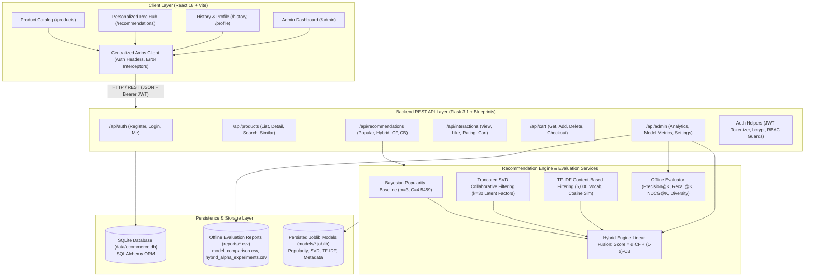
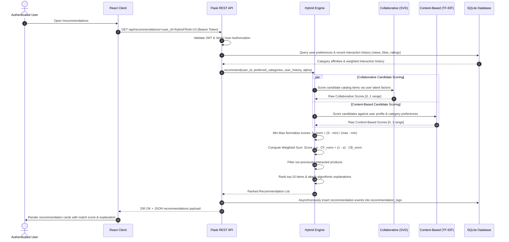

# System Architecture & Technical Specification
## Personalized E-Commerce Recommendation System (Hybrid CF + CB)

---

## 1. High-Level Architecture Diagram

---

## 2. Recommendation Dataflow & Scoring Pipeline

---

## 3. Mathematical Formulation of Recommenders

### 3.1 Bayesian Weighted Popularity Baseline
$$\text{Score}(i) = \frac{v_i}{v_i + m} \cdot R_i + \frac{m}{v_i + m} \cdot C$$
- $v_i$: Total interaction count for product $i$.
- $R_i$: Mean empirical rating of product $i$.
- $m$: Minimum interaction threshold ($m = 3$).
- $C$: Global mean rating across the entire catalog ($C = 4.5459$).

### 3.2 Collaborative Filtering (Truncated SVD Matrix Factorization)
The sparse user-item interaction matrix $R \in \mathbb{R}^{|U| \times |I|}$ is approximated via low-rank decomposition:
$$R \approx U_k \Sigma_k V_k^T$$
- $k = 30$ singular values.
- Predicted preference: $\hat{r}_{u, i} = \mathbf{u}_u \cdot \mathbf{v}_i^T$.
- Item-item latent cosine similarity:
  $$\text{sim}_{\text{CF}}(i, j) = \frac{\mathbf{v}_i \cdot \mathbf{v}_j}{\|\mathbf{v}_i\| \|\mathbf{v}_j\|}$$

### 3.3 Content-Based Filtering (TF-IDF + Cosine Distance)
Product text documents are constructed by concatenating `title`, `category`, and `description`.
$$\text{TF-IDF}(t, d, D) = \text{TF}(t, d) \times \left( \log \frac{1 + |D|}{1 + \text{DF}(t, D)} + 1 \right)$$
User profile vector:
$$\mathbf{p}_u = \sum_{j \in H_u} w_{u,j} \cdot \mathbf{d}_j + \sum_{c \in P_u} \gamma_c \cdot \mathbf{c}_c$$
Cosine similarity:
$$\text{Score}_{\text{CB}}(u, i) = \frac{\mathbf{p}_u \cdot \mathbf{d}_i}{\|\mathbf{p}_u\| \|\mathbf{d}_i\|}$$

### 3.4 Hybrid Fusion
$$\text{Score}_{\text{Hybrid}}(u, i) = \alpha \cdot \text{Score}_{\text{CF, norm}}(u, i) + (1 - \alpha) \cdot \text{Score}_{\text{CB, norm}}(u, i)$$
Where $\alpha \in [0.0, 1.0]$. Empirical offline evaluation on $N=2,064$ test users proved $\alpha = 0.25$ produces peak ranking accuracy:
- **Recall@10:** 20.99%
- **NDCG@10:** 0.1420
- **Catalog Coverage:** 41.63%
- **Intra-List Diversity:** 0.5945

---

## 4. Database Entity-Relationship (ER) Schema

```mermaid
erDiagram
    USERS ||--o{ USER_PREFERENCES : has
    USERS ||--o{ INTERACTIONS : performs
    USERS ||--o{ RECOMMENDATION_LOGS : receives
    USERS ||--o| USER_CART : owns
    USER_CART ||--o{ CART_ITEMS : contains
    PRODUCTS ||--o{ CART_ITEMS : references
    PRODUCTS ||--o{ INTERACTIONS : targets
    PRODUCTS ||--o{ RECOMMENDATION_LOGS : logged_in

    USERS {
        int id PK
        string name
        string email UK
        string password_hash
        string role
        datetime created_at
    }

    PRODUCTS {
        int id PK
        string external_product_id UK
        string title
        text description
        string category
        float price
        float rating
        string image_url
    }

    USER_PREFERENCES {
        int id PK
        int user_id FK
        string category
        float preference_weight
    }

    INTERACTIONS {
        int id PK
        int user_id FK
        int product_id FK
        string interaction_type
        float rating
        datetime timestamp
    }

    RECOMMENDATION_LOGS {
        int id PK
        int user_id FK
        int product_id FK
        string algorithm
        float recommendation_score
        datetime created_at
    }

    USER_CART {
        int id PK
        int user_id FK
        datetime created_at
        datetime updated_at
    }

    CART_ITEMS {
        int id PK
        int cart_id FK
        int product_id FK
        int quantity
    }
```

